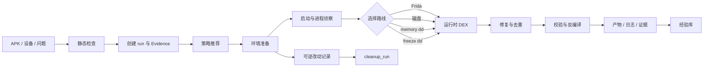

# APK Unpack Agents

## 把 Android 脱壳，从一次性脚本变成可复现的 Agent 工作流

**APK Unpack Agents（APU）** 是一个面向授权安全研究、兼容性分析和软件取证的 Android APK 分析工具。

它把 APK 静态检查、设备准备、运行时 DEX 获取、修复校验、JADX 反编译、证据记录和经验复用串成一条可追踪的工作流，并同时提供：

- **CLI**：适合本地脚本、批处理和 CI；
- **MCP stdio server**：让 Claude Code、Codex 或其他 MCP 客户端可以直接调用；
- **Web 后台**：提供登录、上传、任务队列、实时事件、聊天、Agent / Skill / MCP 管理和产物下载。

你可以把它理解为：

> 一个知道如何选择脱壳路线、能保留证据、会记录失败经验，并且可以被 Agent 调用的 APK 分析底座。

> **使用边界**：只分析你拥有或明确获准测试的 APK、设备和运行环境。工具不会赋予你绕过授权、窃取数据或攻击第三方应用的权利。详见 [DISCLAIMER.md](DISCLAIMER.md)。

## 为什么需要它

Android 脱壳通常不是“运行一个命令”：

1. 先判断 APK 是普通包、资源型混合包，还是带有不同保护壳；
2. 再结合设备 ABI、root、Frida、进程状态和壳特征选择路线；
3. 运行时获取到的 DEX 可能跨内存区、带有损坏头部、重复文件或不完整代码；
4. 某次成功的方法，下一次未必适用于另一台设备、另一个 ABI 或另一个壳版本；
5. 如果没有运行记录，失败很难复盘，成功也很难复现。

APU 把这些判断、回退、修复、验证和记录固化在同一个 run 中。每次运行都保留输入、阶段、尝试过的方法、生成的产物、证据、设备改动和清理状态。

## 你会得到什么

### 从 APK 到可验证产物

- 识别包名、版本、Manifest、ABI、框架和常见壳信号；
- 提取 `assets/`、uni-app `.wgt` 等可直接恢复的业务资源；
- 通过 Frida、磁盘路径、`/proc/<pid>/mem` 或冻结进程等路线获取运行时 DEX；
- 修复 DEX `file_size`、SHA-1、Adler32，去重并稳定命名；
- 校验 DEX 头部、校验和、签名、类表和包名统计；
- 使用 JADX 生成 Java / 资源输出，并保留部分成功和恢复信息；
- 导出包含证据、日志和产物索引的完整运行包。

### 从一次成功到可复用经验

APU 的经验库会根据已完成任务记录：

- 哪种壳、ABI、框架和设备组合出现了什么症状；
- 哪些方法失败、哪个回退路线成功；
- 启动崩溃、反调试、反模拟器和 native bridge 等问题；
- 证据链接、适用范围、成功次数和限制。

经验是历史参考，不会被当成绝对事实。只有经过重复验证的路线才会影响后续策略排序。

### 从脚本到 Agent

同一套工具契约同时服务 CLI、MCP 和 Web 后台。Agent 可以先问：

> “检查这个 APK，告诉我它可能用了什么壳，给出下一步路线，并在每个结论旁边保留证据。”

然后按工具结果继续检查设备、准备环境、运行目标、获取 DEX、修复、验证和反编译。静态结论、运行时事实、推导策略和历史经验在结果中分开标记。

## 能力地图

| 阶段 | 能力 | 结果 |
| --- | --- | --- |
| 识别 | APK、Manifest、DEX 头部、ABI、框架、壳特征 | 静态检查与证据 |
| 资源 | `assets/`、uni-app / Hybrid 资源提取 | 可下载的资源目录 |
| 设备 | adb、root、ABI、SDK、SELinux、Frida 状态 | 设备能力快照 |
| 策略 | 根据壳、ABI、框架和进程事实推荐主路线与回退链 | 可解释的策略 |
| 运行 | 启动目标、进程侦察、内存区评分 | PID、maps、TracerPid、候选区域 |
| 获取 | Frida in-memory / mCookie、磁盘 pull、memory dd、freeze dd | 原始 DEX |
| 修复 | 头部修复、校验和、去重、命名 | `dexdump/fixed/` |
| 验证 | DEX 完整性、类表、包名、JADX 质量 | 验证报告 |
| 交付 | Java 源码、资源、日志、证据和运行状态 | ZIP / 目录 / JSON |
| 复盘 | 自动经验、手工经验、经验导入导出 | 可搜索的 lesson store |
| 编排 | CLI、MCP stdio、Web 任务队列和聊天 | 多种使用入口 |

当前内置的壳识别与路线知识覆盖 ijiami、Bangcle、360 Jiagu、Tencent MTP、SecNeo，以及混合 / 双层保护场景。识别结果是证据驱动的判断；未知覆盖会保留为 `unknown`，不会被强行解释成“没有保护”。

## 它如何工作



每次运行默认会创建类似下面的目录：

```text
run_20261020T120000Z_ab12cd34/
├── run.json                 # 阶段、策略、尝试、产物和清理状态
├── evidence.jsonl           # 内容寻址的 ev_<sha256> 证据账本
├── events.jsonl             # 工具调用与阶段时间线
├── mutations.json           # 设备改动与恢复命令
├── dexdump/
│   ├── raw/                 # 原始 DEX / 内存片段
│   ├── fixed/               # 修复、去重和重命名后的 DEX
│   └── jadx/                # JADX 输出与质量报告
├── assets/                  # APK 资源
└── logs/                    # Frida、命令和运行日志
```

`Evidence` 使用内容寻址 ID。大文件只在证据中记录路径、摘要和 SHA-256，不把整个 DEX 塞进 MCP 响应；当结果过大时，可以分页读取或导出完整证据包。

## 代码结构

```text
src/apk_unpack/
├── domain/                  # Result、Evidence、错误、运行目录和领域模型
├── contracts/               # CLI 与 MCP 共用的 ToolSpec / JSON Schema
├── application/             # 工作流、策略、DEX 校验和经验记忆
├── providers/               # APK、AXML、adb、进程、内存、Frida、JADX 适配器
├── cli.py                   # argparse CLI
└── mcp_server.py            # 零依赖 JSON-RPC stdio server

backend/
├── server.py                # HTTP API、登录、SSE 和 MCP 入口
├── jobs.py / engines.py     # 任务队列、确定性 Agent、LLM tool loop
├── chat.py                  # 对话、附件和后台操作
├── providers.py             # OpenAI / Anthropic / auto 模型接入
├── agents.py / skills.py    # Agent、Skill、MCP 资源管理
├── lessons.py               # Web 侧经验自动生成与去重
├── db.py / security.py      # SQLite、账号、密钥和审计
└── static/                  # 无前端构建依赖的 Web UI

tests/                       # CLI、MCP、DEX、策略、内存和运行时测试
backend/tests/               # 后台、任务、资源、聊天和经验库测试
docs/                        # 架构、安装、CLI、MCP 契约和设计说明
.agents/skills/              # 可安装到 Agent 的 unpack-android-apk Skill
```

依赖方向保持为：

```text
domain → contracts → application / providers → CLI / MCP
```

CLI 和 MCP 都调用同一个 `ToolService`。Web 后台通过任务引擎复用这套服务，因此不会因为入口不同而维护三份脱壳逻辑。

## 快速开始

### 1. 安装与体检

前提是 Python 3.10+。项目本身不依赖第三方 Python 包，但运行时按功能使用本机已有的 `adb`、`frida`、`aapt`、Java 和 JADX。

```powershell
cd apk-unpack-agents
python -m pip install -e .
apu doctor --json
```

也可以不安装，直接运行：

```powershell
$env:PYTHONPATH = "$PWD\src"
python -m apk_unpack doctor --json
```

APU 不会偷偷安装或升级外部工具；`doctor` 会报告缺失项和修复建议。

### 2. 先看 APK，再决定是否运行

```powershell
apu inspect-apk .\target.apk --json
apu strategy <run_id> --json
```

`inspect-apk` 是静态检查，不会启动 APK。`strategy` 只给出主路线、回退路线、前置条件、风险和不建议尝试的方法。

### 3. 执行完整工作流

```powershell
# 目标已经安装到设备
apu unpack .\target.apk

# 需要安装 base + split APK 时
apu unpack .\target.apk --install

# 需要保留现场供复盘时
apu unpack .\target.apk --install --no-cleanup
```

完成后可以查看运行状态、导出证据或手动清理：

```powershell
apu run-state <run_id> --events --json
apu export-evidence <run_id> --out .\evidence.zip
apu cleanup <run_id>
```

### 4. 接入 MCP 客户端

先生成或预览安装计划：

```powershell
python -m apk_unpack setup --project-dir .
python -m apk_unpack setup --project-dir . --yes
```

通用客户端可以直接打印配置片段：

```powershell
python -m apk_unpack setup --client generic
```

MCP server 使用 stdio JSON-RPC，工具目录来自 [`src/apk_unpack/contracts/tools.py`](src/apk_unpack/contracts/tools.py)。具体契约见 [`docs/mcp-contracts.md`](docs/mcp-contracts.md)。

### 5. 启动 Web 后台

```powershell
cd backend
$env:PYTHONPATH = "..\src"
$env:APU_WEB_ADMIN_USER = "admin"
$env:APU_WEB_ADMIN_PASSWORD = "change-me"
python -m backend serve
```

浏览器打开 `http://127.0.0.1:8080`。后台提供：

- APK 上传、任务队列和 SSE 实时进度；
- DEX、源码、日志、证据和完整运行包下载；
- 确定性 Agent、OpenAI / Anthropic / auto Provider 和自定义 Agent；
- Skill、HTTP / stdio MCP 管理与 ZIP 导入；
- 设备登记、任务取消、重试、清理和存储管理；
- 聊天页：自然语言查询任务、设备、上传和经验库，也可以在明确请求时创建资源；
- 经验库检索、导出、导入和自动去重。

Linux 环境可以使用 [`backend/docker-compose.yml`](backend/docker-compose.yml) 同时启动 Web 后台和 redroid。生产环境请修改默认账号、密码和密钥配置。

## 这个项目的价值

### 让结果可复现

每一步都对应明确的输入、工具、参数、输出和状态。别人拿到 `run.json`、证据包和日志后，可以知道一次分析究竟做了什么。

### 让失败也能积累

失败的方法链、错误症状和适用范围会进入经验库。下一次遇到相近的壳 / ABI / 设备组合时，系统可以召回历史路线，而不是从头猜测。

### 让 Agent 有事实可用

模型不需要直接“猜”反编译结果。它可以调用结构化工具，读取证据、限制和产物，再决定下一步。`observed`、`derived` 和 `inferred` 分开表达，降低把推测说成事实的风险。

### 让设备改动可收尾

Frida server、adb forward、库名临时改动、冻结进程等设备变化会进入 `mutations.json`，`cleanup_run` 按逆序尝试恢复。源 APK 始终只读，运行产物写入独立目录。

### 让工具可替换

外部工具通过 provider 适配，工作流通过 contracts 暴露。你可以从 CLI 开始，也可以接入 MCP 或 Web；可以使用确定性 Agent，也可以绑定自己的模型 Provider。

## 与“脚本集合”相比，APU 的优势

| 维度 | 脚本集合 | APK Unpack Agents |
| --- | --- | --- |
| 路线选择 | 依赖操作者记忆 | 壳 / ABI / 设备事实驱动的策略与回退 |
| 失败处理 | 终端日志容易丢失 | run、事件、证据、产物和错误结构化保存 |
| DEX 质量 | 常常只输出 dump 文件 | 修复、去重、校验和类统计作为独立阶段 |
| 经验复用 | 依赖笔记 | 自动记录、检索、去重和重复验证 |
| Agent 接入 | 需要重新写胶水 | CLI 与 MCP 共用 ToolSpec 和结果契约 |
| 设备安全 | 清理动作分散 | 设备改动集中登记，可执行清理 |
| 交付方式 | 单机命令 | CLI、MCP、Web、ZIP 证据包 |
| 大结果处理 | 容易截断或失控 | 摘要、分页、路径引用和导出预算 |

## 当前状态与边界

- 静态 APK 检查、DEX 修复 / 验证、策略、CLI 和 MCP 协议可以离线验证；
- 动态链路依赖 root、adb、Frida、匹配架构的 frida-server 和目标运行环境；
- JADX 的源码完整度会受到壳、混淆、损坏 DEX、内存和超时影响；部分成功会保留已恢复产物，并标记质量限制；
- redroid / native bridge 对部分 ARM-only 壳存在环境限制，实验性 shield 不能保证绕过所有新版本保护；
- “识别到壳”不等于“已经恢复全部业务代码”，“DEX 校验通过”也不等于“每个类都成功反编译”；
- 本仓库当前没有提交正式 `LICENSE` 文件。公开发布前，请补充你确认的许可证、第三方工具条款和发行说明。

详细限制和待补样本见 [`docs/functional-gaps.md`](docs/functional-gaps.md)；完整安装说明见 [`docs/installation.md`](docs/installation.md)。

## 文档入口

- [架构说明](docs/architecture.md)
- [工具设计](docs/tool-design.md)
- [CLI 参考](docs/cli.md)
- [MCP 契约](docs/mcp-contracts.md)
- [安装与环境](docs/installation.md)
- [经验记忆](docs/memory.md)
- [Web 后台说明](backend/README.md)
- [Agent Skill](.agents/skills/unpack-android-apk/SKILL.md)
- [技术版 README](docs/README-technical.md)

## 贡献方向

欢迎围绕这些方向提交 issue 或 pull request：

- 新壳、新 ABI、新设备底座和新的可复现实验样本；
- 更准确的静态识别、路线策略和 DEX 验证；
- Evidence、运行目录、MCP Schema 和错误恢复；
- Web 后台的任务可观测性、资源管理和多用户隔离；
- 文档、测试夹具、安装脚本和跨平台支持。

贡献时请说明：目标类型、设备 / ABI、问题描述、复现步骤、使用过的路线、生成的证据和已知限制。请不要提交 APK、密钥、账号、私有数据或未经授权的应用样本。

## 名称

**APU** 可以理解为 **Android Package Unpack Agents**：它不是只负责“把壳剥掉”，而是把 Android 包分析过程中需要的检查、决策、执行、验证和复盘组织成可以被人和 Agent 共同使用的系统。
